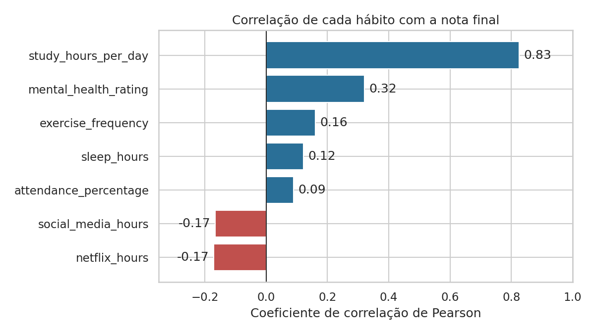
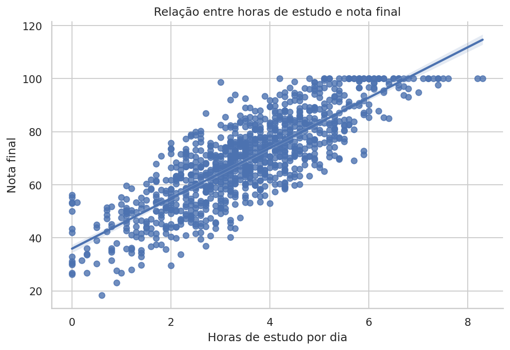
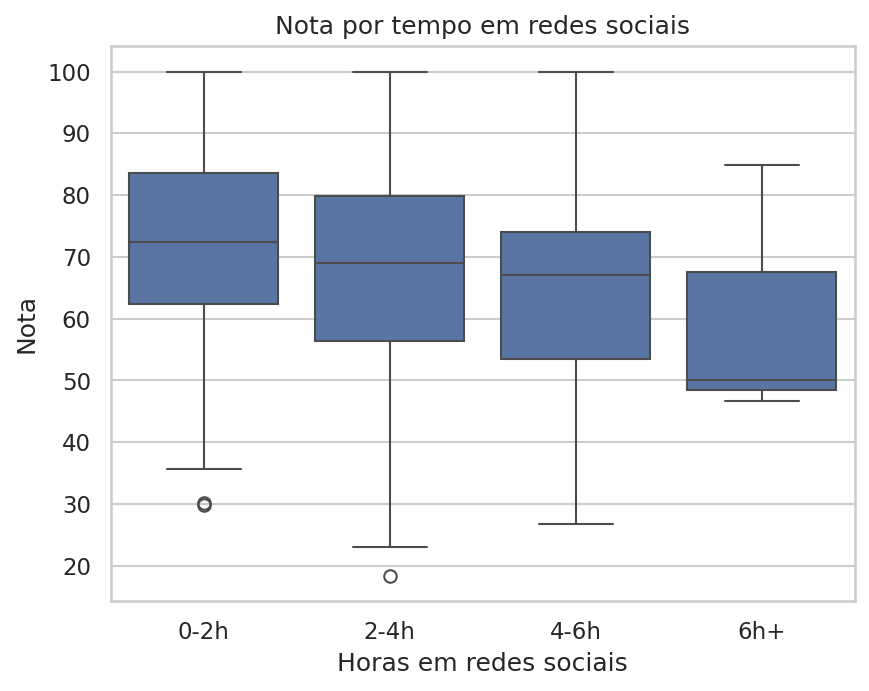
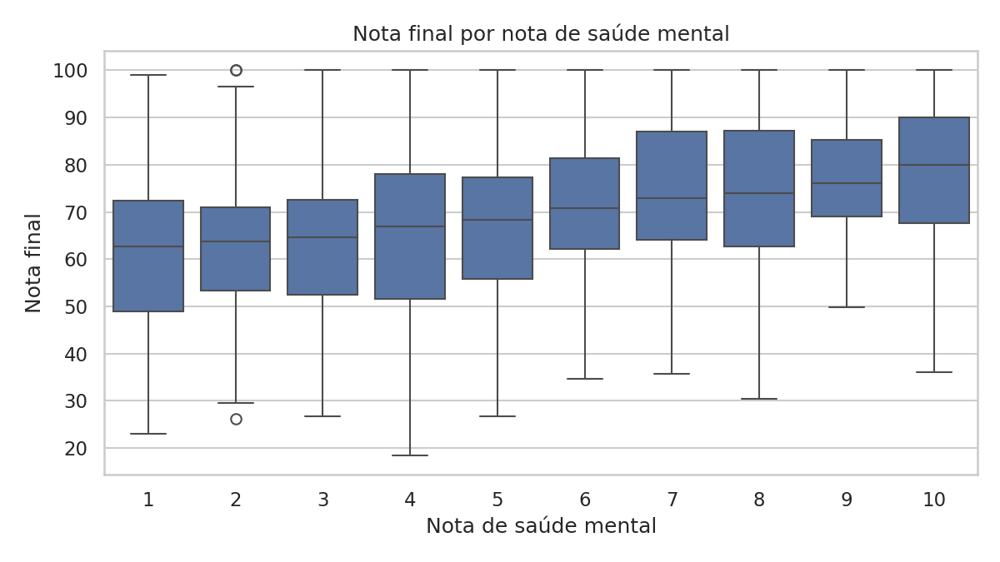
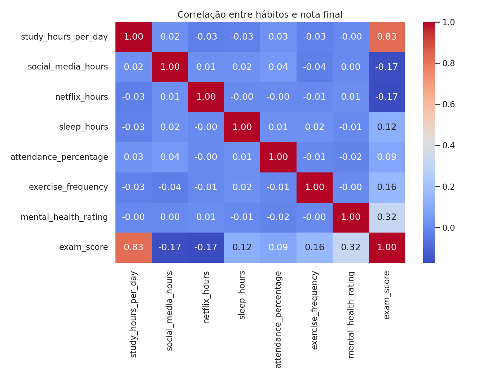

# Hábitos dos estudantes e desempenho nas provas

Análise exploratória de dados que investiga quais hábitos dos estudantes (estudo, redes sociais, sono, exercício, saúde mental e alimentação) estão mais associados à nota final.

**Ferramentas:** Python · pandas · matplotlib · seaborn · Jupyter

> **Origem dos dados e crédito:** projeto prático desenvolvido a partir do vídeo "[TÍTULO DO VÍDEO]" ([LINK DO VÍDEO]), do canal **Eficiência Programada**. O arquivo `student_habits_performance.csv` (1.000 estudantes, 16 colunas) corresponde ao dataset *Student Habits vs Academic Performance*, do Kaggle ([LINK DO DATASET E LICENÇA]). Os dados são **sintéticos**, isto é, gerados artificialmente, portanto os resultados servem como exercício e não descrevem estudantes reais.

---

## Pergunta de negócio

Quais hábitos estão mais associados à nota final dos estudantes?

## Principais resultados

> Como os dados são sintéticos, os resultados abaixo ilustram a técnica de análise e não o comportamento de estudantes reais.

| Hábito | Correlação com a nota | Leitura |
|---|---|---|
| Horas de estudo por dia | **0,83** | Associação forte |
| Nota de saúde mental | 0,32 | Associação moderada |
| Frequência de exercícios | 0,16 | Associação fraca |
| Horas de sono | 0,12 | Associação fraca |
| Presença nas aulas | 0,09 | Associação muito fraca |
| Redes sociais | -0,17 | Associação negativa fraca |
| Streaming | -0,17 | Associação negativa fraca |

- **Estudo:** quem estuda mais de 5h por dia (155 alunos) tem média de **90,8**, contra **45,6** de quem estuda menos de 2h (133 alunos), uma diferença de cerca de 45 pontos.
- **Redes sociais:** a nota média cai de 72,8 (0-2h por dia) para 65,0 (4-6h).
- **Saúde mental:** a nota média sobe de 62,4 (nota 1) para 78,0 (nota 10).
- **Alimentação e gênero:** diferenças desprezíveis.











## Processo

1. **Entendimento da base:** tipos de dados, dicionário de colunas e amostra.
2. **Validação:** nulos, duplicatas e alunos no teto da escala (nota 100).
3. **Correlação:** mapa de calor e ranking dos hábitos em relação à nota.
4. **Comparações por grupo:** estudo (mais de 5h x menos de 2h), faixas de redes sociais, exercícios, saúde mental, alimentação e gênero.
5. **Interpretação:** cada gráfico acompanha um texto de leitura, e o notebook termina com conclusões e limitações.

## Além da análise base

A análise base reúne o mapa de calor, o gráfico de estudo, as comparações por grupo e as estatísticas por gênero. Este repositório acrescenta:

- Validação dos dados (nulos, duplicatas, teto de 100)
- Ranking visual das correlações
- Tabela de alunos e média por faixa de redes sociais
- Títulos e rótulos nos gráficos, com os gráficos salvos na pasta `images/`
- Textos de interpretação, conclusões e limitações

## Limitações

- Os dados são sintéticos: as relações refletem como foram gerados, não o mundo real.
- Correlação não é causalidade.
- Os hábitos se influenciam entre si, e a análise olha um hábito por vez.
- Há um teto em 100 (48 alunos, 4,8%), e os grupos "6h+ em redes sociais" (3 alunos) e gênero "Other" (42 alunos) são muito pequenos.
- A coluna `parental_education_level` tem 91 valores nulos (9,1%) e não foi usada.

## Como reproduzir

```bash
git clone https://github.com/GabrielMarteloti/analise-habitos-estudantes.git
cd analise-habitos-estudantes
pip install -r requirements.txt
jupyter notebook analise_habitos_estudantes.ipynb
```

## Estrutura

```
├── analise_habitos_estudantes.ipynb   # notebook completo, com saídas
├── dados/
│   └── student_habits_performance.csv
├── images/                            # gráficos gerados pelo notebook
└── requirements.txt
```

## Autor

**Gabriel Marteloti** · [LinkedIn](https://www.linkedin.com/in/gabriel-marteloti-815750329/)
